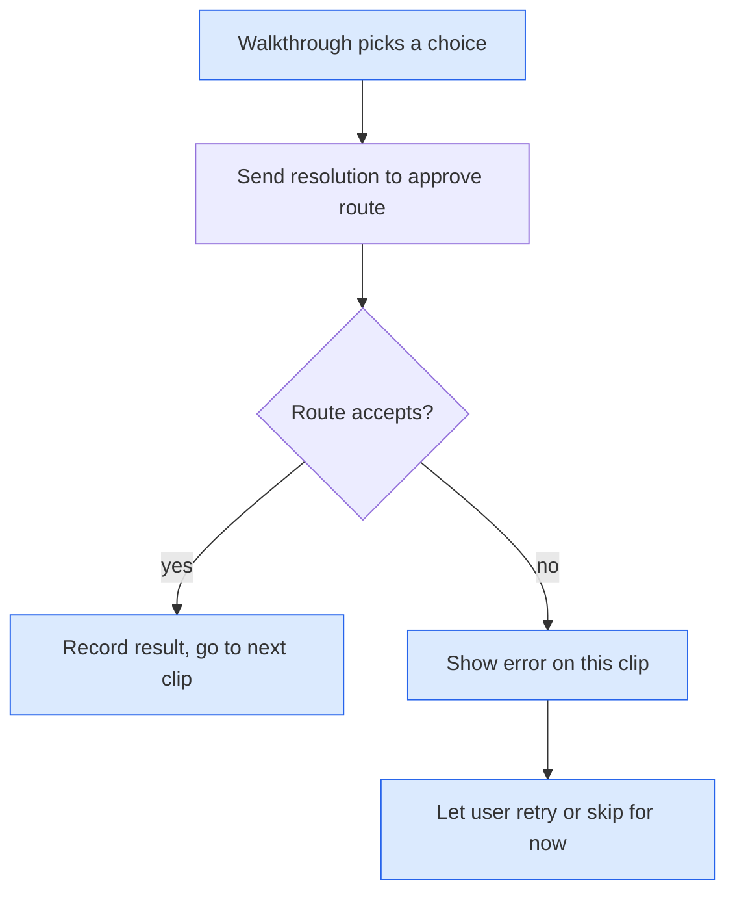
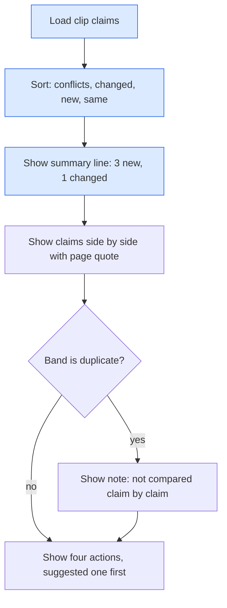
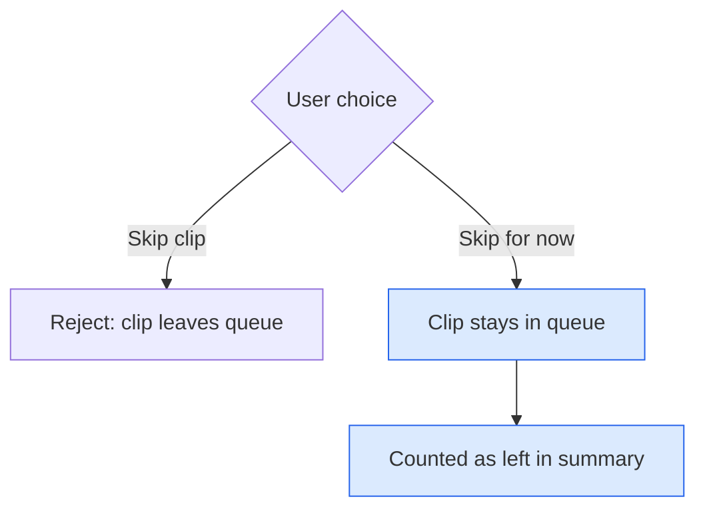
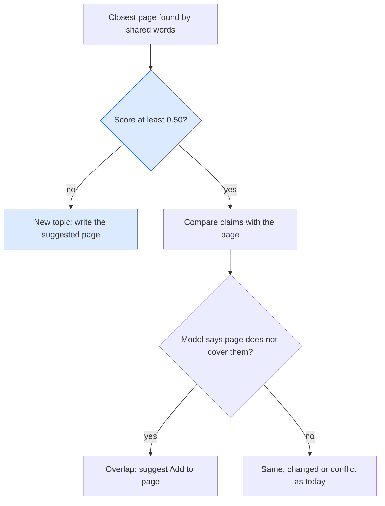
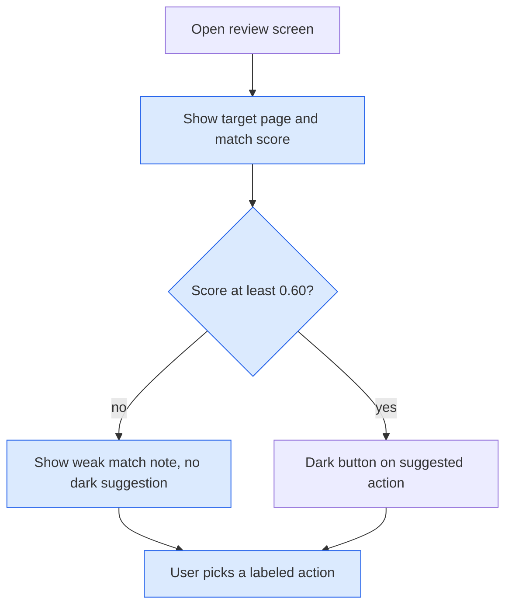
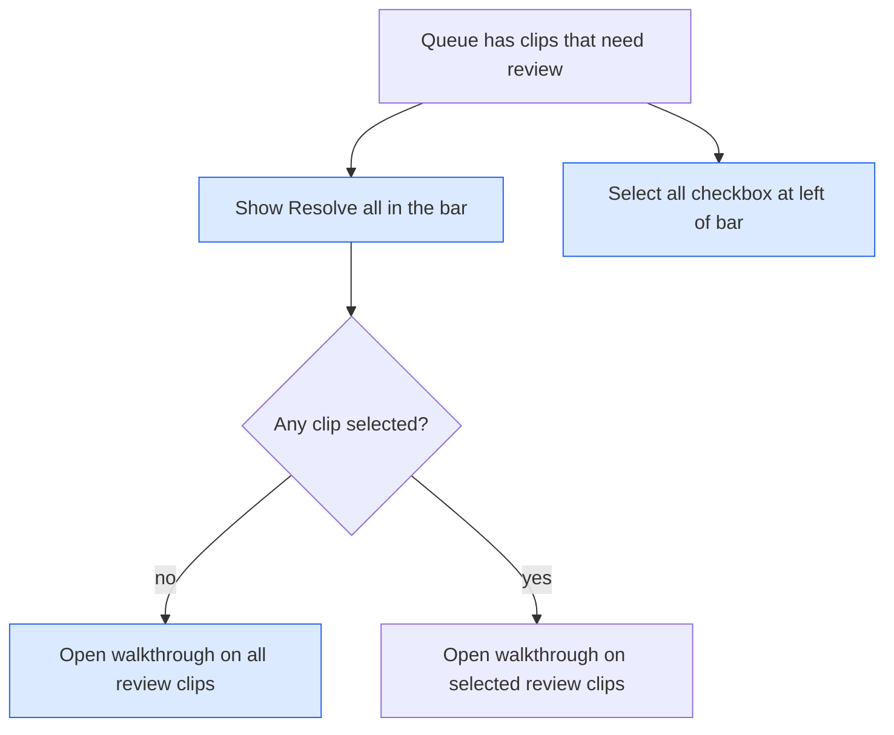
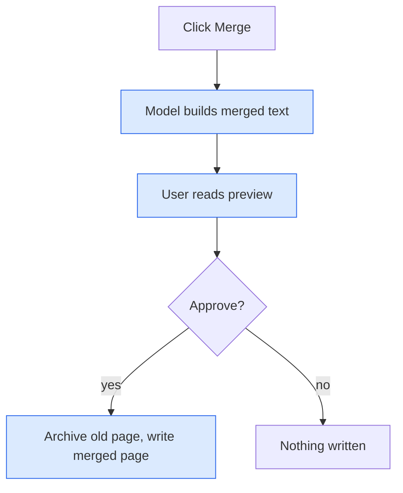
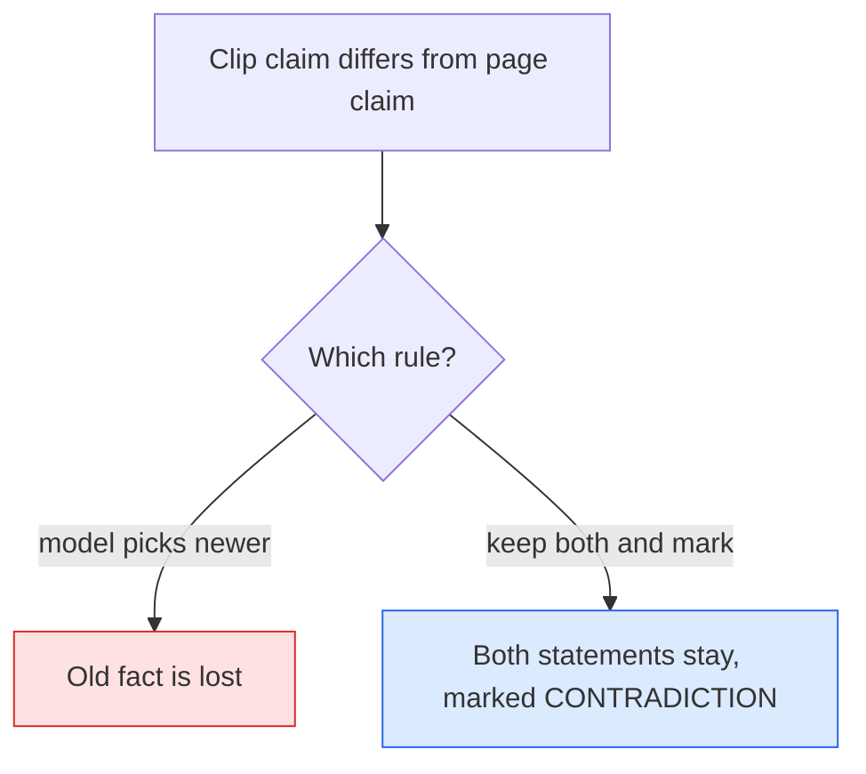
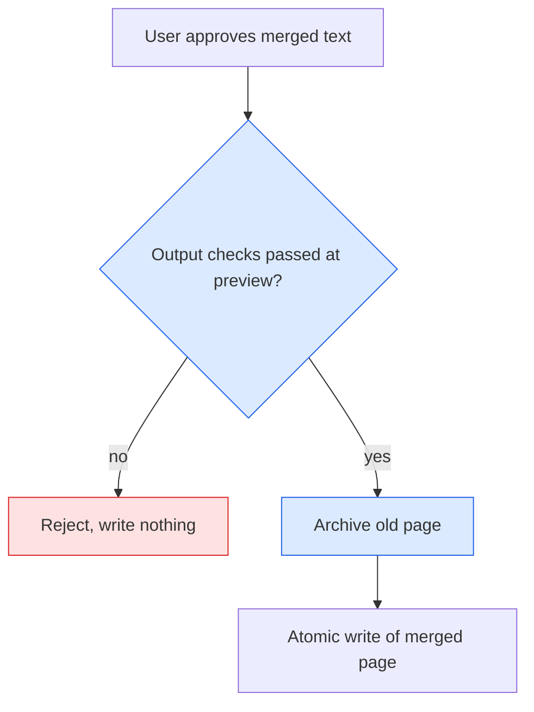

# ADRs: Bulk Resolve Walkthrough

Explainer for all ADRs below: [bulk-resolve-walkthrough-flow.html](../visuals/bulk-resolve-walkthrough-flow.html)

## ADR 1: Walkthrough runs on the existing approve route

### Visual Level

Blue is new. The route is unchanged. One failed clip never stops the others.

**Context.** Resolving needs a human choice per clip. The route `POST /approve/{id}` already takes a `resolution` and checks page staleness.

**Options.**
1. Call the existing route once per clip from the browser.
2. Add `POST /queue/batch-resolve` that takes a list of choices.

**Choice.** Option 1.

**Consequences.** No backend change and no new tests there. The walkthrough shows each result at once. Given up: one request per clip instead of one atomic batch. A crash halfway leaves some clips done. This is fine because each clip is independent.

## ADR 2: Show new content first, one clip per screen

### Visual Level

**Context.** The user wants to understand what each clip adds before choosing. The current modal lists claims in extraction order and hides counts in small chips.

**Options.** (1) Keep order. (2) Sort by risk and add a plain summary line.

**Choice.** Option 2. Summary line example: "3 new claims. 0 change or conflict the page."

**Consequences.** The risky claims appear first. Given up: claim order no longer follows the source text.

## ADR 3: "Skip for now" is separate from "Skip clip"

### Visual Level

**Context.** "Skip clip" rejects and deletes the clip from the queue. A user in a long walkthrough may not be ready to decide.

**Choice.** Add a "Decide later" button that moves on without writing or rejecting.

**Consequences.** Clips are never lost by accident. Given up: one more button on the screen.

## Open questions

1. Should the walkthrough offer "Apply suggested action to all remaining"? It is faster. It also hides the per-clip look the user asked for. Not included. Decide before build.
2. The writer adds the text "CONTRADICTION flagged" and `maturity` counts `[!warning]` callouts. These two strings differ, so flagged contradictions may not lower the maturity score. Not verified. Out of scope here.
3. Clips with `conflicts` verdicts have no "resolve the contradiction" action. Only Replace removes old claims. A "mark old claim superseded" action would be a separate change.
4. The working tree has unrelated uncommitted changes on branch `fix-haiku5-thinking`. Implementation should start on a new branch from `main`.

---

# Change 2: Weak targets and clearer actions

Explainer for ADRs 4 to 6: [weak-target-default-flow.html](../visuals/weak-target-default-flow.html)

## ADR 4: Raise the closest-page cutoff to 0.50

### Visual Level

Blue is changed. Weak matches skip review and become new pages.

**Context.** Live clips matched unrelated pages at 0.37 to 0.43. The cutoff was 0.35, a starting value that was never calibrated. The labeled pairs show distinct clips at 0.29 or less and true overlaps at 0.56 or more.

**Options.**
1. Raise the cutoff to 0.50, near the middle of the gap.
2. Keep 0.35 and let the model decide relevance with a new prompt field.
3. Keep 0.35 and make "Create new page" the default for all-new overlaps.

**Choice.** Option 1. It is one constant, needs no model call, and the pairs support it. Option 2 adds model cost. Option 3 still shows the user a review screen for pages that are not related.

**Consequences.** Unrelated pages no longer attract clips. Given up: a true overlap that scores between 0.35 and 0.50 now becomes a new page and is not offered an Add. No labeled pair sits in that range, so the size of this loss is unknown. The user can still add a clip to a page by hand.

## ADR 5: Name the target page on every action

### Visual Level

**Context.** "Add to page" does not say which page. The dark "suggested" button invites one click.

**Options.** (1) Keep the labels. (2) Put the page name in each label and drop the suggestion when the match is weak.

**Choice.** Option 2. Labels: "Add to {page}", "Create new page {suggested}", "Replace {page}", "Skip clip".

**Consequences.** The user sees where text will go before the click. Given up: longer buttons, which may wrap on narrow windows. The 0.60 line is a first guess.

## ADR 6: Always show Resolve, and a Select all checkbox

### Visual Level

**Context.** The Resolve button appears only after a selection. "Select all ready" is faint text. The user could not find a way to take all clips together.

**Options.** (1) Keep as is. (2) Always show the button, and replace the text link with a checkbox.

**Choice.** Option 2.

**Consequences.** One click starts the walkthrough on every review clip. Given up: a little more bar width.

## Open questions for change 2

1. The five live clips have no hand label yet. I treat them as `distinct` because their pages are about agents, RAG and security, and the clips are about SEO. Confirm before they enter the pairs.
2. The 0.50 cutoff is a midpoint guess. There is no labeled pair between 0.29 and 0.56. More pairs in that range would set it better.
3. Clips already in the queue keep their old reports. They need a rebuild with `POST /queue/{id}/compare`. That writes to your live queue file, so I would ask first.
4. The result summary does not list where each clip went. A per-clip list with links is a separate small change.
5. There is still no real merge action. Add to page appends a section. A rewrite-merge is a larger change.
6. The 0.60 "strong match" line may be too high or low. It needs real use.

# Change 3: A true merge action

## ADR 7: Merge shows a preview before it writes

### Visual Level

Explainer: [merge-action-flow.html](../visuals/merge-action-flow.html).

**Context.** A model rewrite of a page can drop facts or invent text. A one-click rewrite would hide that.

**Options.** (1) One click: rewrite and write. (2) Preview, then write on approval. (3) Write, then offer undo.

**Choice.** Option 2.

**Consequences.** The user sees every change before it lands. Given up: one extra click and one extra model call before the write. The preview text may be stale if the page changes, so the hash check stays.

## ADR 8: Merge keeps both sides of a conflict

### Visual Level

Explainer: [merge-action-flow.html](../visuals/merge-action-flow.html).

**Context.** Append already flags contradictions and keeps old text. Merge must not be worse.

**Options.** (1) The model picks the newer claim. (2) The model keeps both and marks the conflict. (3) Ask the user per claim.

**Choice.** Option 2. The user edits the preview if they want a winner.

**Consequences.** No fact is lost without the user seeing it. Given up: the merged page may carry conflict markers until the user resolves them by hand. Option 3 is a later change.

## ADR 9: Archive the old page and check the model output

### Visual Level

Explainer: [merge-action-flow.html](../visuals/merge-action-flow.html).

**Context.** Replace already archives to `_wiki/meta/replaced/`. Merge is a rewrite and has the same risk.

**Options.** (1) No archive. (2) Archive, as Replace does. (3) Archive and run output checks.

**Choice.** Option 3. Checks: not empty, at least 60% of the old length, no more old numbers dropped than the clip has numbers, first heading unchanged.

**Consequences.** A bad rewrite is rejected or can be undone from the archive. Given up: the checks are crude. A rewrite that drops a fact without a number passes. The preview is the main guard.

## Open questions for change 3

1. Which model writes the merge? Decided: Haiku (2026-11-06). Revisit if merges of long pages come out thin.
2. The 60% length check and the number check are guesses. They need a few real merges to tune.
3. Pages over 6000 characters: `capture_compare` caps page text at 6000. A merge of a long page needs the full text, so the cap must not apply here. Cost grows with page size.
4. There is no undo button. The archive holds the old page, and restoring is manual. A restore action is a separate change.
5. The merged page keeps conflict markers until the user edits them. Per-claim choice (option 3 in ADR 8) is deferred.
