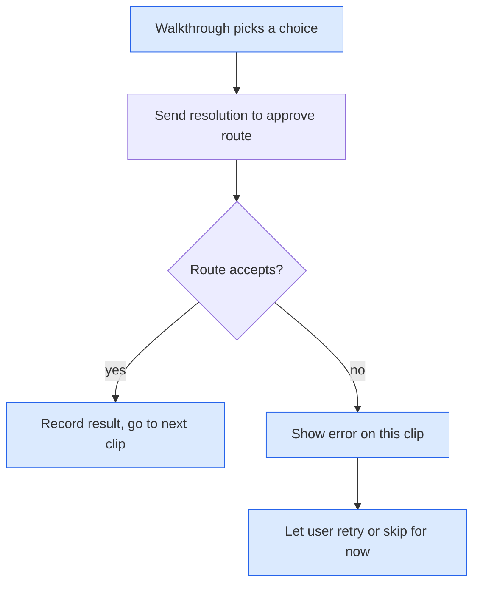
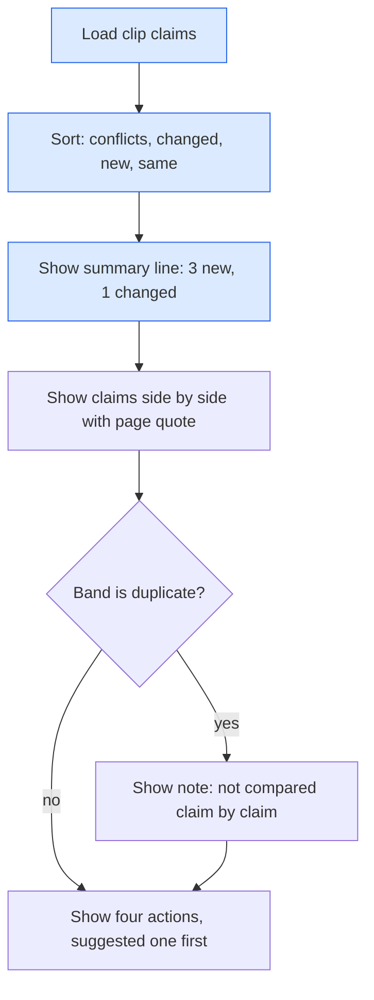
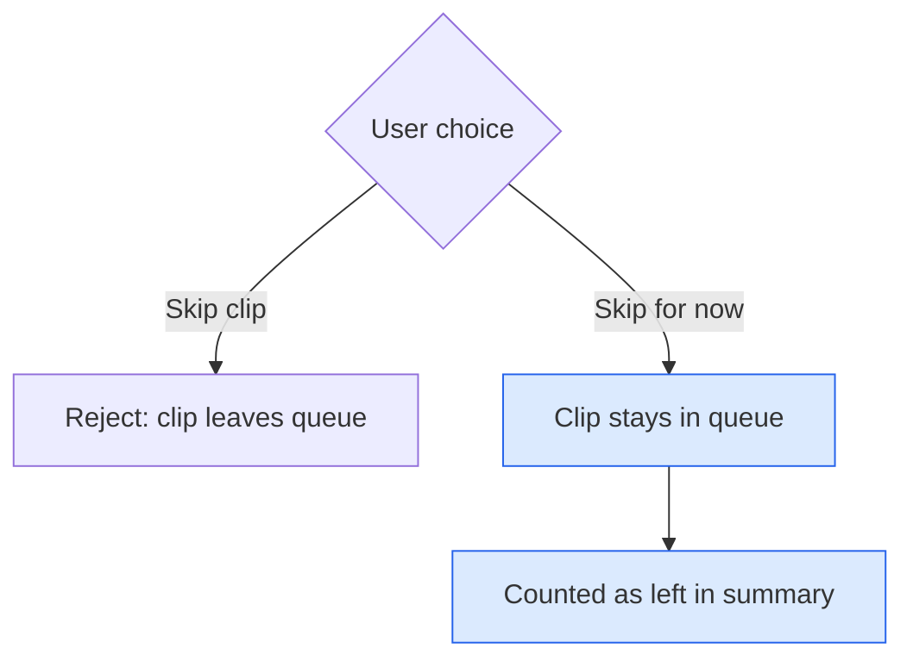

# ADRs: Bulk Resolve Walkthrough

Explainer for all ADRs below: [bulk-resolve-walkthrough-flow.html](../visuals/bulk-resolve-walkthrough-flow.html)

## ADR 1: Walkthrough runs on the existing approve route

### Visual Level

Blue is new. The route is unchanged. One failed clip never stops the others.

**Context.** Resolving needs a human choice per clip. The route `POST /approve/{id}` already takes a `resolution` and checks page staleness.

**Options.**
1. Call the existing route once per clip from the browser.
2. Add `POST /queue/batch-resolve` that takes a list of choices.

**Choice.** Option 1.

**Consequences.** No backend change and no new tests there. The walkthrough shows each result at once. Given up: one request per clip instead of one atomic batch. A crash halfway leaves some clips done. This is fine because each clip is independent.

## ADR 2: Show new content first, one clip per screen

### Visual Level

**Context.** The user wants to understand what each clip adds before choosing. The current modal lists claims in extraction order and hides counts in small chips.

**Options.** (1) Keep order. (2) Sort by risk and add a plain summary line.

**Choice.** Option 2. Summary line example: "3 new claims. 0 change or conflict the page."

**Consequences.** The risky claims appear first. Given up: claim order no longer follows the source text.

## ADR 3: "Skip for now" is separate from "Skip clip"

### Visual Level

**Context.** "Skip clip" rejects and deletes the clip from the queue. A user in a long walkthrough may not be ready to decide.

**Choice.** Add a "Decide later" button that moves on without writing or rejecting.

**Consequences.** Clips are never lost by accident. Given up: one more button on the screen.

## Open questions

1. Should the walkthrough offer "Apply suggested action to all remaining"? It is faster. It also hides the per-clip look the user asked for. Not included. Decide before build.
2. The writer adds the text "CONTRADICTION flagged" and `maturity` counts `[!warning]` callouts. These two strings differ, so flagged contradictions may not lower the maturity score. Not verified. Out of scope here.
3. Clips with `conflicts` verdicts have no "resolve the contradiction" action. Only Replace removes old claims. A "mark old claim superseded" action would be a separate change.
4. The working tree has unrelated uncommitted changes on branch `fix-haiku5-thinking`. Implementation should start on a new branch from `main`.
