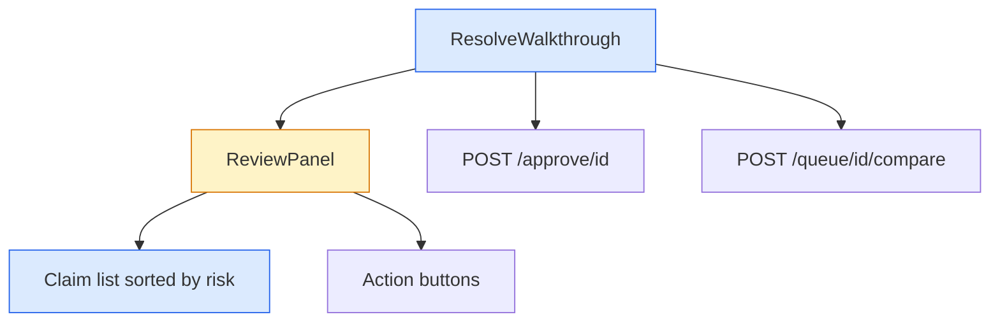

# API: Bulk Resolve Walkthrough

## Visual Level

Blue is a new component. Amber is an existing one that changes. The two routes are unchanged.

## HTTP routes (unchanged)

| Route | Body | Success | Errors |
|---|---|---|---|
| `POST /approve/{id}` | `{approved: bool, resolution?: "append"\|"replace"\|"keep_both"}` | `{success, action, file_written, resolution?, archived?}` | 404 not found. 409 `needs_review` (approve with no resolution). 409 `report_stale`. 500 `archive_failed` or vault write failure. |
| `POST /queue/{id}/compare` | none | `{conflict_report}` | 404 |

Invariant: a clip that overlaps, conflicts or repeats a page is never written without a `resolution`.

## Frontend contracts

`ResolveWalkthrough({ items, onClose, onFinished })`
- `items`: queue items with a `conflict_report`. Fixed at open.
- `onFinished(summary)`: `summary = { done: n, left: n, failed: n }`. Parent reloads the queue and calls `onApproved` when `done > 0`.

`ReviewPanel({ item, report, onResolve(action), busy, stale, onRefresh, error, extraActions })`
- Renders the summary line, the claims and the action buttons.
- `onResolve(action)` where action is `append | keep_both | replace | skip`.
- `extraActions` holds the "Decide later" button. The old modal passes none.

`sortClaims(claims)` returns a new array ordered `conflicts`, `changed`, `new`, `same`. Stable within a verdict.

`summaryLine(claims)` returns a string such as "3 new claims. 1 changes or conflicts with the page."
