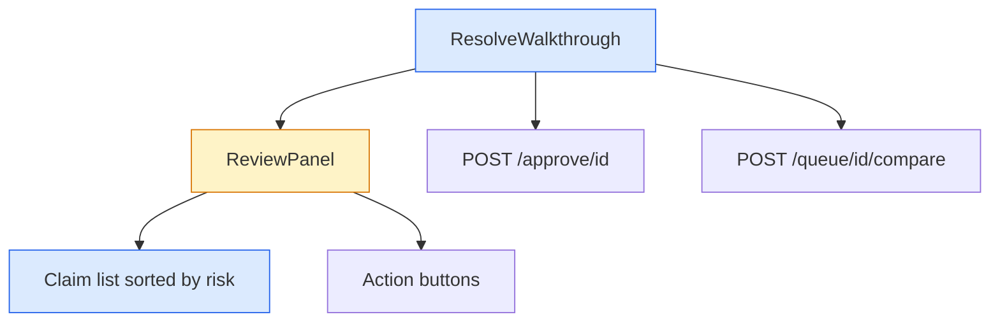
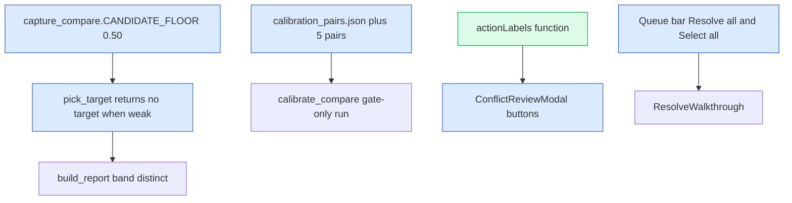

# API: Bulk Resolve Walkthrough

## Visual Level

Blue is a new component. Amber is an existing one that changes. The two routes are unchanged.

## HTTP routes (unchanged)

| Route | Body | Success | Errors |
|---|---|---|---|
| `POST /approve/{id}` | `{approved: bool, resolution?: "append"\|"replace"\|"keep_both"}` | `{success, action, file_written, resolution?, archived?}` | 404 not found. 409 `needs_review` (approve with no resolution). 409 `report_stale`. 500 `archive_failed` or vault write failure. |
| `POST /queue/{id}/compare` | none | `{conflict_report}` | 404 |

Invariant: a clip that overlaps, conflicts or repeats a page is never written without a `resolution`.

## Frontend contracts

`ResolveWalkthrough({ items, onClose, onFinished })`
- `items`: queue items with a `conflict_report`. Fixed at open.
- `onFinished(summary)`: `summary = { done: n, left: n, failed: n }`. Parent reloads the queue and calls `onApproved` when `done > 0`.

`ReviewPanel({ item, report, onResolve(action), busy, stale, onRefresh, error, extraActions })`
- Renders the summary line, the claims and the action buttons.
- `onResolve(action)` where action is `append | keep_both | replace | skip`.
- `extraActions` holds the "Decide later" button. The old modal passes none.

`sortClaims(claims)` returns a new array ordered `conflicts`, `changed`, `new`, `same`. Stable within a verdict.

`summaryLine(claims)` returns a string such as "3 new claims. 1 changes or conflicts with the page."

---

# Change 2: Weak targets and clearer actions

## Visual Level

Blue is changed. Green is a new function. No route, schema or error shape changes.

## Backend

`capture_compare.CANDIDATE_FLOOR: float = 0.50` (was 0.35). Meaning: the lowest word-overlap score at which a page the extractor did not name becomes the compare target. Pages the extractor named still win at any score. Invariant: a report with `band` of `overlap`, `conflict` or `duplicate` always has a `target_page`.

## Calibration data

Each added pair uses the existing schema: `id`, `how_built`, `clip_title`, `clip_claims`, `suggested_page`, `label`, `hide_pages`. New ids: `p41` to `p45`. Label: `distinct`. Source: the five live clips, with the model-labeled claims left out because `distinct` has no claims.

## Frontend

`actionLabels(report, item)` returns `{ append, keep_both, replace, skip }` as display strings. It uses `report.target_page` and `item.suggested_page`.

`isStrongMatch(report)` is true when `report.match_score >= 0.60`. It controls the dark "suggested" button and the "weak match" note.

`QueueSection` bar: `selectAllChecked`, `onToggleAll()`. "Resolve all" opens `ResolveWalkthrough` with every queued clip where `needsReview` is true and extraction is ready.
