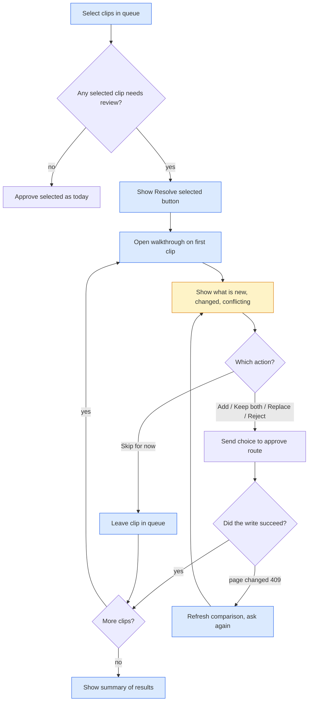

# Architecture: Bulk Resolve Walkthrough

## Visual Level

Blue boxes are new. Amber is an existing screen that now runs inside the walkthrough. White boxes exist today. The walkthrough reuses the current approve route, so no backend code changes.

## Complexity tier

Single-process tool. The change is frontend only. It adds one component and one button. No new route, no new state on disk. A higher tier is not needed.

## Problem

Today "Approve selected" refuses any clip that overlaps or conflicts with a page. The error says "Open each one with Review". The user must find each clip, open the modal, decide, close, and repeat. The user wants to select many clips and walk through them in one flow.

## Components

| Component | Status | Role |
|---|---|---|
| `QueueSection` | changed | Adds the Resolve selected button and holds the walkthrough list |
| `ConflictReviewModal` | changed | Body becomes `ReviewPanel`, reused by the modal and the walkthrough |
| `ResolveWalkthrough` | new | Steps through selected review clips, one per screen |
| `POST /approve/{id}` | unchanged | Writes the page with a `resolution` |
| `POST /queue/{id}/compare` | unchanged | Rebuilds a stale report |

## Data flow

The queue already holds each clip's `conflict_report`. The walkthrough reads it. It sends one `POST /approve/{id}` per decision. The route checks that the target page hash still matches the report. If not, it returns 409 `report_stale`.

## What resolve does to contradictions (current behavior)

Resolve does not remove contradictions. It records them.

| Action | Effect on old page text | Effect on conflicts |
|---|---|---|
| Add to page (`append`) | Old text stays. New section is added. Only the "Current understanding" block is rewritten. | If any claim is `conflicts`, the type becomes `contradicts`. The section gets a "CONTRADICTION flagged, review manually" line and a red badge. Both claims stay on the page. |
| Keep both | Old page untouched except a related link. | New page holds the new claims. Nothing is merged. |
| Replace page | Old page is copied to `_wiki/meta/replaced/`, then overwritten. | The only action that removes old claims. |
| Skip clip | Nothing written. Clip leaves the queue. | None. |

So today resolve adds to the page and flags conflicts for a human. Replace is the only path that deletes. This change does not alter that.

## Open questions

See `adr.md`, section "Open questions".
