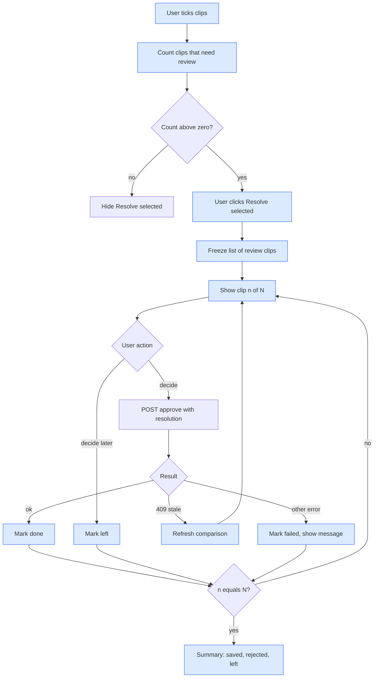

# Logic Flow: Bulk Resolve Walkthrough

## Visual Level

Blue is new. Each clip ends as done, left, or failed. Refresh loops back to the same clip.

## Steps

1. The queue shows a checkbox on each clip. The user ticks several.
2. `reviewIds` = selected clips where `needsReview(conflict_report)` is true and extraction is ready.
3. If `reviewIds` is not empty, the bar shows "Resolve selected (k)". "Approve selected" stays and handles the rest.
4. On click, the walkthrough copies `reviewIds` into a fixed list. Later queue polling does not change the list.
5. For clip n, the screen shows the title, the summary line, the claims sorted by risk, and the four actions plus "Decide later".
6. "Replace page" needs a second click to confirm, as in the current modal.
7. A decision sends `POST /approve/{id}`. `Skip clip` sends `approved: false`. Other actions send `approved: true` and the `resolution`.
8. On success the clip is marked done and the screen moves to the next clip.
9. On 409 `report_stale` the screen refreshes by itself with `POST /queue/{id}/compare` and shows the new claims. Clips are ordered by target page, so clips for the same page are adjacent.
10. On any other error the message shows on the same screen. The user retries or presses Decide later. There is no separate failed state.
11. If the clip is no longer in the queue (404), the error shows and the user presses Decide later.
12. After the last clip, show the summary. Closing it reloads the queue and calls `onApproved` when any page was written.

## State

`{ list, index, results: { [id]: 'done'|'rejected'|'left' } }`. Held in the walkthrough component only. Nothing persists. Closing early leaves unfinished clips in the queue.

## Failure behavior

| Failure | Result |
|---|---|
| Page changed since compare | Refresh, then decide again |
| Network or 500 | Error shows on the clip. User retries or decides later |
| User presses Esc | Walkthrough closes, finished clips stay finished |
| Clip removed elsewhere | Error shows. User decides later |
